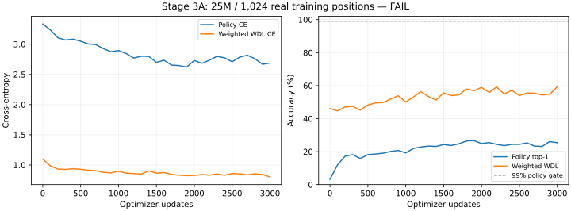

# M2 Stage 3A — 1K-position overfit

**Recommendation: FAIL.**
This is a bounded memorization diagnostic, not a supervised pilot or chess-strength result.

## Source, scope and environment

Branch: `m2/stage-3a-overfit`; merged Stage 2A/2B base: `68e8381bd3457cd2dcbbb0a76588fc07df8192e7`.
Exact source overlay manifest SHA256: `2feccbb0d59f6f86980b91252a8a01948ab84b7eac08a421fd6fdd469d5babb5`.
The owner merged Stage 2A/2B before implementation. Main, origin/main and the Stage 3A branch
were checked via local refs and agreed on that base. No Git command was executed by the agent.
GPU: NVIDIA RTX PRO 6000 Blackwell Server Edition. Versions: `{"flax": "0.12.0", "jax": "0.7.2", "jaxlib": "0.7.2", "optax": "0.2.6", "wandb": "0.28.1"}`.
Hardware: 97,887 MiB physical VRAM, driver 595.71.05; host-visible 160 GiB RAM and 20 logical CPUs.
GPU/driver/CUDA and host details are retained in the compact JSON results and original evidence ZIP.

## Frozen real-data sample

Dataset A revision: `b7ddb96d8ce8cfe55298e01a7d928b0f763e1c4c`; training split only; seed 20261031.
1024 eligible real positions from **1024 different games**, one position per game.
Months: `{"2026-01": 151, "2026-02": 164, "2026-03": 143, "2026-04": 138, "2026-05": 141, "2026-06": 155, "2026-07": 132}`.
Original WDL class counts: `{"0": 484, "1": 82, "2": 458}` (win=0/draw=1/loss=2).
Zero-value-weight time-forfeit rows: **172**; these still contribute to policy loss.
Sampling: SHA256-ranked 2N games from all 35K; minimum position hash rank per game; first N unique encoded inputs.
Scanned/validated training rows per sample build: 2,654,850; two builds.
Duplicate encoded inputs excluded from this derived sample: 42;
of those, 40 had conflicting policy/weighted-WDL targets.
Both minimum-position ranking and candidate-game ranking are seed/SHA256 based, independent of traversal order.
This diversity filter only makes the tiny memorization task unambiguous; it does not modify Dataset A
or prescribe deduplication for a future full-data pilot. Original feature bytes, history, masks and labels are preserved.
Logical sample SHA256: `f2dca7915a44569801b824b2815c04be04703a69827f46b9139f3b7cce1bb498`.
NPZ SHA256: `cc00bda4d5feb8a980be6e32208712f50eb94bb197ae60d01aeaff6e47ced590`; 394,127 bytes compressed.
Two independent full-training-source sample builds produced identical manifests and compressed sample bytes.
All original shard sizes/SHA256, schemas, actions, WDL perspective, weights and source counts were validated.
No PGNs were replayed again; this reuses the previously accepted M1 parity evidence.
Zero dataset bytes downloaded for sample selection. Validation/test and Dataset D were not used for optimization.

## Model, loss and optimizer

25M only: **25,622,092 parameters**, accepted architecture unchanged; bf16 compute, fp32 masters/moments.
Explicit run initialization: random backbone, zero final policy_head and value_head kernels/biases.
This preserves the accepted architecture while making initial probabilities uniform for an exact loss sanity check.
It is an initialization choice for this diagnostic, not a model-source or encoder modification.
Masked policy CE + separately value-weighted WDL CE (coefficient 1). Illegal actions stay masked.
AdamW beta=(0.9,0.95), epsilon=1e-8, zero weight decay; global gradient clip 1.0.
Microbatch 32; 100-step linear warmup from 1e-5 to constant LR 1e-3; no LR sweep or fallback run.
0% history dropout. Every 32 updates is an exact-once permutation of the same 1,024 positions.
Compiled updates reject nonfinite gradients/state. Full-sample metrics are weighted aggregates over 32 minibatches.

## Initial loss sanity

Policy loss **3.33455636**, versus mean ln(legal-count) **3.33455633**.
WDL loss **1.09861232**, versus ln(3) **1.09861229**.
Both agreed within 1e-4 before training. Weighted WDL accuracy excludes zero-weight rows.

## Learning result

| Metric | Initial | Final |
|---|---:|---:|
| Masked policy CE | 3.334556 | 2.688546 |
| Policy top-1 accuracy | 3.2227% | 25.3906% |
| Weighted WDL CE | 1.098612 | 0.802800 |
| Weighted WDL accuracy | 46.1268% | 59.2723% |

Stopped after **3,000 updates**; no later training started.
Predeclared code gate: policy accuracy >=99%, policy CE <=0.05, WDL accuracy >=95%,
both component losses below initial, finite values, within 3,000 updates.
The WDL 95% and policy CE 0.05 thresholds explicitly quantify “rise sharply” and “near zero”.

| Step | Policy CE | Policy accuracy | WDL CE | WDL accuracy |
|---:|---:|---:|---:|---:|
| 0 | 3.33456 | 3.22% | 1.09861 | 46.13% |
| 500 | 3.04905 | 18.16% | 0.93034 | 48.24% |
| 1000 | 2.89480 | 19.24% | 0.89798 | 50.12% |
| 1500 | 2.69924 | 24.32% | 0.86561 | 55.63% |
| 2000 | 2.73012 | 24.90% | 0.82854 | 58.92% |
| 2500 | 2.70902 | 24.41% | 0.86003 | 53.99% |
| 3000 | 2.68855 | 25.39% | 0.80280 | 59.27% |

## Checkpoint and tracking evidence

Exact checkpoint save/restore checks: `[{"bytes": 307476462, "exact_tree_equal": true, "metrics_equal": true, "sha256": "8b9dc5f9c9afce6a37ee7e95ab866e0eb6ae63a38d826d41e86d0449d048b41e", "step": 500}, {"bytes": 307476462, "exact_tree_equal": true, "metrics_equal": true, "sha256": "11c698488c99a16fad9a8b713cc72c4a632f6668807b46eca74bb4b907150de3", "step": 1000}, {"bytes": 307476462, "exact_tree_equal": true, "metrics_equal": true, "sha256": "b793a117363eb6ffde0a6b659008612c907515c659574d9f411c86ba128e82ea", "step": 1500}, {"bytes": 307476462, "exact_tree_equal": true, "metrics_equal": true, "sha256": "38e6a2509b133a8f83b59ac4f8fe4c3f72e30cfdfb9827a6aa4e5eace2557c8a", "step": 2000}, {"bytes": 307476462, "exact_tree_equal": true, "metrics_equal": true, "sha256": "03be7adc9174f15586aae7d8a8a2ee189f893591ddeaa1a293079d8c7613965c", "step": 2500}, {"bytes": 307476462, "exact_tree_equal": true, "metrics_equal": true, "sha256": "e22402a6ce3440060bccd588d73499d453c684793afdb80c9884636836aa0494", "step": 3000}]`.
Restored optimizer/step state used for continued training: **True**.
The CPU test independently verifies the next update is identical after restore, and corruption/metadata mismatch reject.
W&B experiment: [https://wandb.ai/ishagarg-research/gambit-zero/runs/fm3wotuj](https://wandb.ai/ishagarg-research/gambit-zero/runs/fm3wotuj).
Logged minibatch metrics every 10 updates; complete 1K-sample evaluation every 100 updates, including step zero.
LR, gradient norm, policy/WDL losses and accuracies, run configuration and system metrics were recorded.
API keys are read only from environment by the reusable tracker; no secret values or environment dumps are recorded.
Tracker supports explicit online/offline/disabled modes; offline behavior is covered by the focused test.
The final model+optimizer checkpoint was logged as an explicit checkpoint artifact; remote digests match.
With explicit owner approval, the exact source/sample/results archives were also saved as
`ishagarg-research/gambit-zero/stage3a-25m-provenance:v0`; all four remote file digests match.
Artifact names, immutable version digests and per-file hashes are recorded in the results JSON.
A separate CPU-only SDK test verified offline logging without an API key; it performed no model updates.

## Measured resources and timing

Training loop wall time (includes evaluations/checkpoints): **71.869s**.
Synchronized compiled-update execution sum: **45.037s**.
Initialization including compilation/execution: **8.783s**;
training-step tracing + compilation: **11.283s**.
Total worker wall time including setup inside worker/tracking/upload: **137.927s**.
JAX peak bytes in use: **1,252,512,512** (1.166 GiB).
Sampled physical device-wide peak: **2,790,260,736** (2.599 GiB).
Peak host worker RSS: **3,941,883,904** (3.671 GiB).
Physical memory was sampled approximately every 0.2s and includes other processes; brief peaks may be missed.
These are tiny-set training measurements, not full-loader/pilot/self-play throughput.
Molab reported a near-2^63 free-disk sentinel; actual usable disk capacity is not established by that value.
The isolated job completed its bounded I/O. The Mac retains only small derived samples/evidence, not trained weights.

## Verification, tests and remaining blocker

Complete CPU regression: **385 passed in 76.33s**.
Focused CPU tests: **12 passed locally**; **12 passed in Molab's pinned environment**.
Tests cover uniform initial losses, finite updates, exact zero-weight WDL masking, deterministic epoch accounting,
checkpoint integrity/continuation, explicit offline tracking, artifact file selection and sample hashing/deduplication.
Results ZIP SHA256: `0b8551bdca1b6936ae58bff6892a4fe80397b58fb713aeacce4cd958be1c6159`; all indexed members verified.
Source bundle/retained source hashes were checked; original model/rules/encoder/codec/loader/core locks remain unchanged.

**Blocking result:** the model did not memorize the tiny sample within the agreed bound.
Loss reduction alone does not satisfy the gate. No numerical failure or checkpoint discrepancy was observed,
but the learning/implementation root cause is unresolved. Exit code 1 and W&B failed status
deliberately reflect the unmet learning gate; the model worker reported no runtime exception.
Treat this as a blocking diagnostic, not evidence
for proceeding to a pilot or selecting a different learning rate. No second run or sweep was launched.
Next action requires focused review/debugging of this failure before Stage 3B. No chess-strength claim is made.

## Reproduction and manual Git workflow

See [exact commands and recovery limits](../docs/m2_stage3a_run.md).
Stage 2A/2B is already merged; no repeat merge is needed. Stage 3A changes remain uncommitted for owner review.
No history dropout, openings_v2, MCTS, self-play, full pilot or dataset expansion was implemented or executed.
