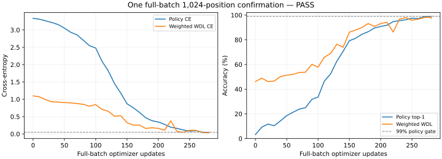

# Stage 3A — single full-batch confirmation — 31 October 2026

**Result: PASS.** Policy gate: accuracy >=99% and masked policy CE <=0.05, checked after every update.
This report supplements the unchanged original failed run and failure diagnosis; it does not overwrite their evidence.
No Stage 3B, full-data pilot, model change or parameter sweep was started.

## Configuration and execution

Same frozen 1,024 eligible training positions, same 25,622,092-parameter model, same seed 20261031,
same random backbone / zero output heads. bf16 compute with fp32 masters and optimizer moments.
Constant peak LR 3e-4, 100-update warmup, AdamW beta=(0.9,0.95), epsilon=1e-8, zero weight decay, clip 1.0.
0% history dropout; all 1,024 rows contribute to every update. No minibatch sampling or shuffle noise.
Execution mode: **32x32-global-normalized-accumulation**. Effective batch 1,024; maximum 2,000 updates; exactly one run launched.
The direct graph was compiled and checked against a conservative GPU memory budget before any update.
Direct backward temporaries were 14,409,274,216 bytes; doubled buffer safety exceeded the 24 GiB guard.
No direct optimizer update was executed. The selected 32x32 accumulation sums global-normalized policy/WDL gradients and clips once after summation;
unit tests cover unequal value counts, all-zero value microbatches and unequal policy weights.
Policy denominator is 1,024; WDL denominator is 852. The 172 forfeits contribute zero WDL gradient.
The current instruction defines acceptance using policy only; WDL metrics are reported separately.

Frozen sample SHA256: `cc00bda4d5feb8a980be6e32208712f50eb94bb197ae60d01aeaff6e47ced590`.
Logical SHA256: `f2dca7915a44569801b824b2815c04be04703a69827f46b9139f3b7cce1bb498`.
Initial parameter SHA256: `1d8de194d0049605769735f46a23b78a51acf4508f78cc7f649135b7fee0ea5b`.
Dataset A remains pinned to `b7ddb96d8ce8cfe55298e01a7d928b0f763e1c4c`; no source datasets, encoder, codec or chess rules changed.

## Actual result

| Metric | Initial | Final |
|---|---:|---:|
| Policy top-1 accuracy | 3.2227% | 99.0234% |
| Masked policy CE | 3.334557 | 0.041589 |
| Weighted WDL accuracy | 46.1268% | 97.4178% |
| Weighted WDL CE | 1.098612 | 0.050313 |

Stopped at **281 updates**; **287,744 position presentations**, or 281 full passes.
Clip-active updates: **270/281 (96.09%)**.
The fraction uses all updates, not sampled logging. Norms before/after clipping are retained in raw evidence.
The earlier minibatch runs saw 96,000 presentations in 3,000 updates (93.75 passes). This run changes both
gradient noise and presentations per update; it does not isolate their individual causal contributions.

W&B: [https://wandb.ai/ishagarg-research/gambit-zero/runs/f9hphmku](https://wandb.ai/ishagarg-research/gambit-zero/runs/f9hphmku). Every update logs losses, accuracy, LR and pre/post clipping norms.



## Final policy error breakdown

Ply is the original zero-based pre-move ply. Bounds are inclusive. Legal counts come from the original Pgx legal mask.
Board hash is the existing Dataset A SHA256 of pieces, side to move, castling and legal en-passant FEN fields;
clocks and board history are excluded. Full encoded inputs are distinct even when current board hashes match.
These are descriptive diagnostics, not a new split, filter or causal test.

### Ply buckets

| Group | Rows | Correct | Missed | Accuracy | Error rate |
|---|---:|---:|---:|---:|---:|
| 0-10 | 138 | 129 | 9 | 93.48% | 6.52% |
| 11-30 | 301 | 300 | 1 | 99.67% | 0.33% |
| 31-60 | 372 | 372 | 0 | 100.00% | 0.00% |
| 61+ | 213 | 213 | 0 | 100.00% | 0.00% |

### Number of legal moves

| Group | Rows | Correct | Missed | Accuracy | Error rate |
|---|---:|---:|---:|---:|---:|
| 1-10 | 69 | 69 | 0 | 100.00% | 0.00% |
| 11-20 | 71 | 70 | 1 | 98.59% | 1.41% |
| 21-30 | 240 | 233 | 7 | 97.08% | 2.92% |
| 31-40 | 428 | 427 | 1 | 99.77% | 0.23% |
| 41+ | 216 | 215 | 1 | 99.54% | 0.46% |

### Shared board hash

| Group | Rows | Correct | Missed | Accuracy | Error rate |
|---|---:|---:|---:|---:|---:|
| shared | 2 | 2 | 0 | 100.00% | 0.00% |
| unique | 1022 | 1012 | 10 | 99.02% | 0.98% |

### Concentration assessment

Misses are not evenly spread: 9/10 (90%) occur at ply 0–10, which contains only 138/1024 (13.48%) of the sample. Early error rate is 9/138 = 6.52%, versus 1/886 = 0.113% later (about 57.8x). The other miss is at ply 21. Seven misses have 21–30 legal moves. Both shared-hash rows are correct (0/2 misses); every missed row has a unique board hash. Residual errors are concentrated in early-position discrimination, not exact duplicate-board groups. This does not establish an approximate near-duplicate mechanism.

Only two rows share a board hash (one group), so that stratum cannot establish a general near-duplicate effect.
No approximate board-similarity metric was added; current-board hash equality is narrower than “near duplicate”.
Evenly spread errors would be consistent with budget/noise; early-ply concentration would warrant position-discrimination
review. Neither pattern alone proves its mechanism, especially if very few misses remain.

### All missed rows

| game_id | Ply | Legal moves | Shares board hash |
|---|---:|---:|---|
| adebkN2D | 4 | 39 | False |
| pqjebixA | 3 | 20 | False |
| m3LihCPJ | 3 | 22 | False |
| 5tfL4zbR | 4 | 29 | False |
| 9zSaxLgK | 4 | 28 | False |
| dSJF9zKA | 2 | 21 | False |
| aiWaiX4o | 3 | 22 | False |
| pLGg3WLG | 21 | 27 | False |
| QELdK1he | 3 | 27 | False |
| cRzUsVrs | 8 | 42 | False |

All missed identities are listed above without truncation; indices, board hashes and target/predicted actions are also in the JSON.

## Earlier D comparison and limitations

The earlier D run (microbatch 32, LR 3e-4) ended at 77.34% / policy CE 0.7080.
Its checkpoint was not retained locally or in a W&B checkpoint artifact; only metrics/history remain.
Therefore the D per-row breakdown is **unavailable**. It was not reconstructed by rerunning D, and the original
LR-1e-3 checkpoint was not silently substituted. Current per-row predictions and checkpoint are retained for future read-only review.

## Runtime, memory and verification

Training wall time including evaluation: **65.229s**; synchronized update execution: **54.308s**.
Tracing/compilation phases: `{"accumulation_trace_compile_seconds": 13.458621118000337, "direct_trace_compile_seconds": 14.212899817999642, "init_seconds": 9.984233508000216}`.
Total worker wall time including initialization, compile, checkpoint and tracking completion: **154.900s**.
JAX allocator peak: **1.430 GiB**; physical sampled peak: **2.604 GiB**.
Host peak RSS: **3.178 GiB**. Physical sampling includes other processes and may miss brief peaks.
These are full-batch tiny-sample measurements, not full-dataset training throughput or generalization.
Tests: **4 focused passed; 394 full CPU regression passed in 78.72s**.
Final checkpoint save/restore reproduces parameter fingerprint and evaluation metrics exactly; weights remain outside Git.
Original source, frozen sample and old evidence hashes were verified unchanged.
Raw results archive SHA256: `61c8fe4fa7c1c2e840ba83784401eaf992d5ae60d92004a4594ee34f6176fb0d`; all indexed members verified.
The complete per-update curve is retained in the raw archive and W&B; the [compact results JSON](m2_stage3a_fullbatch_confirmation_results.json)
contains the 10-update curve plus the exact final step, all final predictions, subgroup counts and hashes.

## Interpretation and stopping point

Stage 3A PASS under the requested confirmation gate. The unchanged model and frozen sample reach >=99% policy accuracy with CE <=0.05 when gradients are globally accumulated. This supports the interpretation that the earlier broad gap involved minibatch gradient noise and exposure/step budget rather than broken mapping, masks or optimizer state. These factors were changed jointly and are not individually isolated. Residual early-ply concentration remains visible and should not be described as evenly spread noise. This is an engineering memorization gate, not evidence of held-out performance or chess strength. Stop for owner review; Stage 3B remains unstarted.

No further tuning, model redesign, Stage 3B, commit, push or merge was performed.

## Reproduction

Use the existing pinned Molab environment and unchanged frozen `input/` sample. Start from a fresh guarded output directory
only if a future repetition is explicitly authorized. No second run was executed here.

```bash
JAX_PLATFORMS=cpu .venv/bin/python -m pytest tests/test_fullbatch_confirmation.py -q
JAX_PLATFORMS=cpu .venv/bin/python -m pytest -q
# Exact authorized command inside the existing Molab source directory:
JAX_PLATFORMS=cuda XLA_PYTHON_CLIENT_PREALLOCATE=false JAX_DEFAULT_MATMUL_PRECISION=highest \
  .venv/bin/python scripts/confirm_stage3a_fullbatch.py
```
