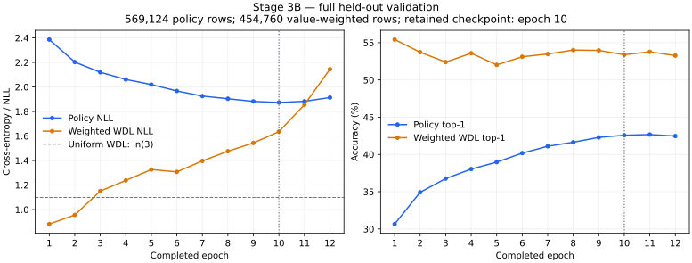

# M2 Stage 3B — 25M supervised pilot

Execution dates: 9–10 November 2026. Branch: `m2/stage-3b-supervised`.
Base: `9c53aabad8ef8eeaa4bc7373fa307d1f94683284`.

**CONDITIONAL PASS for the completed 25M training execution.** The smoke, matched
three-point LR comparison and fresh pilot completed; the pilot early-stopped at
12 epochs. Policy validation improved, but value NLL/Brier deteriorated and need
review before further scaling. No implementation cause for that gap is established
by these experiments. This is not full M2 acceptance or a frozen B0 checkpoint.

## Fixed recipe and data

Reuse the accepted 25,622,092-parameter model, bf16 compute with fp32 master
parameters/moments and sensitive reductions, masked policy CE and value-weighted
WDL CE. Microbatch 32 × 32 accumulation = 1,024, shuffle buffer 32,768, seed
20261109, history dropout 0%. AdamW beta=(0.9,0.95), epsilon 1e-8, kernel weight
decay 0.01, clipping 1.0 after accumulation, 1,000-step warmup and cosine to 10%
of peak. Each run initializes afresh; no overfit or sweep checkpoint initializes
the pilot. Configuration: [stage3b_25m.json](../configs/stage3b_25m.json).

Dataset A remains pinned to
`b7ddb96d8ce8cfe55298e01a7d928b0f763e1c4c`:
2,654,850 training positions, 569,124 August validation positions. September test
Parquet is not opened. Original checksum-verified train/validation files total
1,730,442,889 bytes across 678 files and are reused between runs/epochs. No archive
scan, data repacking, feature/rules/codec changes or new Mac dataset copies.
Time-forfeit rows keep policy targets and zero WDL weight. Tail padding has zero
policy and WDL weight; every real eligible position contributes once per epoch.

## Completed GPU gate

RTX PRO 6000 Blackwell Server Edition, 97,887 MiB reported VRAM, driver
595.71.05; Python 3.11.15, JAX/JAXlib/CUDA plugin 0.7.2, Flax 0.12.0,
Optax 0.2.6, Pgx 2.6.0, mctx 0.0.6, W&B 0.28.1. Host reports 20 logical CPUs
and approximately 160 GiB RAM. Host/cgroup RAM checks passed. The virtualized
filesystem reports implausibly large free space; this does not establish a
physical storage quota. Known dataset/checkpoint sizes and disk reserves bound
planned storage, not an independently measured host quota.

- Bounded smoke: **PASS**, two finite optimizer updates, exact checkpoint restore,
  unchanged frozen smoke sample. Compile 13.3716 s; synchronized updates 0.2160 s
  and 0.1926 s; sampled whole-device peak 2,790,260,736 bytes.
- [Smoke W&B run](https://wandb.ai/ishagarg-research/gambit-zero/runs/r5o2i73f).
- Focused CUDA suite: **33 passed in 89.64 s**.
- Complete CPU regression on the packaged implementation: **423 passed in 89.72 s**.
  No training-logic change was made during recovery.

## Matched learning-rate comparison

Each candidate: 2,593 optimizer updates, all 2,654,850 training positions, full
569,124-row validation. Initial parameter fingerprint is identical:
`476d36106002d3fb180fa7707716f0947a0084f0c226a2e2ef6647f0c103e56d`.
Selection uses full validation policy NLL, with lower LR as a tie-break; test data
is not used. Sweep schedules each span one epoch; the pilot schedule spans 20,
so their first-epoch trajectories are not identical.

| Peak LR | Validation policy NLL | Policy top-1 | Weighted WDL NLL | Run |
|---|---:|---:|---:|---|
| 1e-4 | 2.564940 | 26.4271% | 0.850552 | [rb1nh3c2](https://wandb.ai/ishagarg-research/gambit-zero/runs/rb1nh3c2) |
| **3e-4** | **2.350768** | **31.5940%** | **0.849427** | [ur0tedut](https://wandb.ai/ishagarg-research/gambit-zero/runs/ur0tedut) |
| 6e-4 | 2.379311 | 30.9592% | 0.855355 | [h919nyul](https://wandb.ai/ishagarg-research/gambit-zero/runs/h919nyul) |

Selected LR: **3e-4**. Validation has 454,760 nonzero-value-weight positions.
This is a policy-NLL selection, not a claim that all value metrics improve.

### Owner pause and exact recovery

The owner paused the 3e-4 candidate after all training updates but before full
validation. The new Molab host recovered the 307,476,475-byte checkpoint from
W&B artifact `stage3b-owner-paused-lr0.0003-latest-checkpoint:v0`; downloaded bytes
matched SHA256
`0e250857e22bb9d6760c7c955627224a6fd595fa60c72ca0367812bab3f04fb5`.
Recovery recreated the deterministic loader, discarded its already-consumed
prefix and performed **zero new optimizer updates**. The final checkpoint SHA
remained identical and validation covered all 569,124 rows. Interrupted status
was an owner-requested `KeyboardInterrupt`, not a nonfinite/correctness failure.
Recovery/replay overhead makes elapsed-time comparisons unequal even though
training-update budgets and initial weights match. The overnight gap is not
included in active experiment time.

## Selected pilot — completed with early stopping

[W&B training/validation curves](https://wandb.ai/ishagarg-research/gambit-zero/runs/fqtmu0xe),
group `m2-supervised`. Fresh initialization, LR 3e-4. Stopped after **12 epochs /
31,116 updates / 31,858,200 training-position presentations**: epochs 11 and 12
failed to improve policy NLL by 1e-4. The 20-epoch/12-hour cap was not reached.
The retained best is epoch **10**, step **25,930**, selected by full validation
policy NLL; epoch 11 had slightly higher accuracy but worse NLL.

| Completed epoch | Policy NLL | Policy top-1 | Weighted WDL NLL | Weighted WDL top-1 | Material NLL improvement |
|---:|---:|---:|---:|---:|---|
| 1 | 2.386536 | 30.656% | 0.881843 | 55.423% | yes |
| 2 | 2.202817 | 34.922% | 0.956132 | 53.721% | yes |
| 3 | 2.119491 | 36.763% | 1.151036 | 52.396% | yes |
| 4 | 2.061100 | 38.035% | 1.237569 | 53.587% | yes |
| 5 | 2.019370 | 38.972% | 1.326545 | 52.023% | yes |
| 6 | 1.967365 | 40.183% | 1.307215 | 53.112% | yes |
| 7 | 1.925496 | 41.102% | 1.396993 | 53.481% | yes |
| 8 | 1.903864 | 41.641% | 1.476029 | 54.007% | yes |
| 9 | 1.882287 | 42.293% | 1.543406 | 53.964% | yes |
| 10 | 1.873244 | 42.579% | 1.635764 | 53.385% | yes |
| 11 | 1.882878 | 42.672% | 1.854732 | 53.776% | no |
| 12 | 1.913764 | 42.473% | 2.144768 | 53.267% | no |



The plot uses the entire validation population at each epoch. W&B additionally
preserves all 1,257 logged pilot history rows, including batch curves. Keys are
`train_batch/policy_loss`, `train_batch/wdl_loss`, their accuracies, and the
corresponding `validation/` keys. The optimization objective is policy CE + 1.0 ×
weighted WDL CE. Logged batch metrics are post-update minibatch metrics, not a
full-training-population evaluation; console `loss` is the pre-update combined
objective. Neither should be presented as full-training-population NLL.

### Initial sanity and value-quality limitation

Before training: policy NLL **3.2308256626**, versus
mean ln(legal actions) **3.2308257649**; weighted WDL CE
**1.0986121704**, versus ln(3). The first batch has 1,024 policy rows
and 822 value-weighted rows. Every update passed the runner’s finite checks.

At the retained best: policy top-3 **69.332%**, WDL accuracy
**53.385%**, WDL NLL **1.635764**, and three-class summed Brier
**0.710530**. WDL NLL and Brier are worse than uniform probabilities
(ln(3) ≈ 1.0986 and Brier 2/3), despite WDL top-1 accuracy above chance. This is
a substantial probability-quality/generalization concern. Calibration and class
diagnostics were not run here; overfitting/overconfidence is an interpretation,
not a confirmed implementation root cause. No loss coefficient, LR, architecture
or dataset was changed to respond to it. The last epoch was worse still:
policy NLL 1.913764, WDL NLL 2.144768.

Best-checkpoint phase strata (zero-based ply; these are not board-disjoint tests):

| Stratum | Policy rows | Policy NLL | Policy top-1 | Weighted WDL NLL |
|---|---:|---:|---:|---:|
| ply < 10 | 74,886 | 1.420208 | 52.066% | 0.945962 |
| ply ≥ 10 | 494,238 | 1.941888 | 41.142% | 1.745457 |

### Measured performance and memory

| Measurement | Selected pilot |
|---|---:|
| Active experiment wall time | 13087.164 s / 3.6353 h |
| Initialization / training-kernel compilation | 7.619 s / 17.994 s |
| Synchronized optimizer execution | 6208.989 s |
| Synchronized update throughput | 5130.98 real positions/s |
| End-to-end throughput, including validation/I/O | 2434.31 training positions/s |
| Loader wait | 3712.567 s |
| Full-validation time, summed over 12 epochs | 2585.335 s |
| Sampled whole-GPU peak used memory | 2,798,649,344 bytes / 2.606 GiB |
| JAX allocator peak bytes in use | 1,470,347,520 bytes |
| Trainer process peak RSS | 4,462,850,048 bytes / 4.156 GiB |
| Clip-active updates | 31,109/31,116 (99.9775%) |
| Dataset bytes downloaded during the pilot | 0 |

Whole-GPU memory is sampled and can miss brief peaks; allocator telemetry is
reported separately. RSS is the trainer process, not a whole-host peak. The
update rate is full model forward/backward/AdamW with accumulation; it is not
environment throughput or MCTS/self-play performance. Clipping activates very
often; this is measured behavior of the accepted recipe, not evidence of an
implementation bug or a reason to silently change the run.

Uninterrupted sweep measurements: 1e-4 compiled in 13.518 s, synchronized
5,237.61 positions/s, end-to-end 2,644.85 positions/s; 6e-4 compiled in 18.585 s,
5,139.52 synchronized and 2,362.96 end-to-end positions/s. Both sampled peaks were
2,798,649,344 bytes. Recorded experiment wall times were 1,003.782 s / 1,530.068 s
/ 1,123.527 s for 1e-4 / resumed 3e-4 / 6e-4. The resumed result includes 625.683 s
of new-session replay/validation and zero optimizer execution, so it is not an
uninterrupted throughput measurement.

The three candidates plus pilot consumed **4.6513 active GPU-host experiment hours**.
This uses recorded process wall time, not integrated GPU busy time or billing.
It excludes overnight idle time, setup/prefetch, the 37.954 s smoke and 89.636 s
CUDA tests; the latter two add 0.0354 h. The resumed receipt omits approximately
2.37 s between the pause checkpoint and interrupted-process exit. No OOM or
nonfinite/correctness failure occurred. Initial packaging omitted the W&B lockfile;
it was corrected before training without changing dependency versions.

### Retained checkpoint and external evidence

- Immutable best artifact: `ishagarg-research/gambit-zero/stage3b-25m-pilot-lr0.0003-checkpoint:v9`.
- Checkpoint: **307,476,475 bytes**, SHA256
  `712d997b2b1e435533e56d71e9e332e3dd3f3748a5675bdfe75ed94e380a74a5`.
- Verified with a fresh destination and explicit `skip_cache=True` download,
  then full-file SHA256, byte count and checkpoint receipt equality. GPU reported
  0 MiB used / 0% utilization after the trainer exited.
- Metrics/evidence artifact: `ishagarg-research/gambit-zero/stage3b-25m-execution-evidence:v0`
  ([archive job](https://wandb.ai/ishagarg-research/gambit-zero/runs/6nhe0u0r)), **164,909 bytes**. It contains scientific
  result/receipt JSON and all logged scalar history points (105 per candidate,
  1,257 pilot); no source, human records, credentials or weights.
- Evidence gzip SHA256: `74b0d9a86196d6b2d022afb591b3f000658ad38ccb5ec4e98a1158cf63477fd3`; upload and an
  uncached round-trip download matched. The archive contains the full source-file
  hashes and configuration alongside the measured results. Raw runtime evidence
  stays outside Git; dataset shards and weights were not copied to the Mac.

The Hugging Face API resolved the pinned dataset revision unchanged. No Dataset A
or Dataset D write was performed. The CUDA runtime packages actually installed
were jax-cuda12-plugin/pjrt 0.7.2, nvidia-cuda-runtime-cu12 12.9.79 and cuDNN
9.27.0.42. System `nvcc` reports CUDA 13.3; that is distinct from JAX’s pip CUDA
12 runtime. W&B is 0.28.1.

## Reproduction and pending scope

See [the run guide](../docs/m2_stage3b_run.md) for exact CLI flags and approved
budgets. Experiment evidence remains ignored under
`data/processed/stage3b_execution/`; effective source/sample bundle SHA256 is
`8cba0aeed8d808e2a65a94c5dbef5d75b204dbfe51616e1e95df0c6712d3f4cc`.
Credentials are supplied only through Molab environment secrets.

Executed regression commands (the CUDA command ran in the pinned remote venv):

```bash
JAX_PLATFORMS=cpu .venv/bin/python -m pytest -q
JAX_PLATFORMS=cuda XLA_PYTHON_CLIENT_PREALLOCATE=false \
  JAX_DEFAULT_MATMUL_PRECISION=highest .venv/bin/python -m pytest -q \
  tests/test_supervised_pilot.py tests/test_fullbatch_confirmation.py \
  tests/test_policy_head_mapping.py
```

The execution controller invokes the accepted CLI below, with shared environment
`JAX_PLATFORMS=cuda`, `XLA_PYTHON_CLIENT_PREALLOCATE=false`, and
`JAX_DEFAULT_MATMUL_PRECISION=highest`. Paths are on the GPU host; a fresh output
is required for new experiments. Downloads were prefetched and checksummed once
per Molab host rather than repeated each epoch.

```bash
.venv/bin/python -u scripts/run_supervised_pilot.py --mode sweep --lr-index 0 \
  --store /marimo/gambit-zero-stage3b/originals \
  --output /marimo/gambit-zero-stage3b/runs/lr-0 --execute-approved --wandb-mode online
# Original candidate index 1 used the same flags with lr-index/output changed.
# After its owner pause, the exact same candidate was restored with --resume:
.venv/bin/python -u scripts/run_supervised_pilot.py --mode sweep --lr-index 1 \
  --store /marimo/gambit-zero-stage3b/originals \
  --output /marimo/gambit-zero-stage3b/runs/lr-1 --execute-approved --resume --wandb-mode online
.venv/bin/python -u scripts/run_supervised_pilot.py --mode sweep --lr-index 2 \
  --store /marimo/gambit-zero-stage3b/originals \
  --output /marimo/gambit-zero-stage3b/runs/lr-2 --execute-approved --wandb-mode online
.venv/bin/python -u scripts/run_supervised_pilot.py --mode pilot --lr 0.0003 \
  --store /marimo/gambit-zero-stage3b/originals \
  --output /marimo/gambit-zero-stage3b/runs/pilot --execute-approved --wandb-mode online
```

**Recommendation: CONDITIONAL PASS for this 25M pilot execution, with value
probability quality unresolved.** Review the retained checkpoint/curves and value
generalization before any new scaling or training experiment. No additional run
was launched in response to the findings.

No 100M run, history dropout, openings_v2, MCTS, self-play or dataset expansion.
Rating strata, train-board-disjoint validation, WDL calibration/class diagnostics
and puzzle/match evaluation remain outside this execution; no playing-strength
or final-B0 claim is made. No commit, push or merge was performed.
